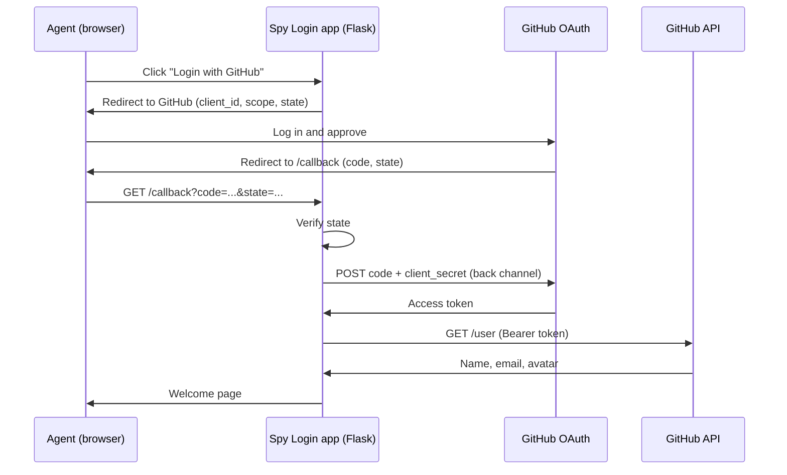

# Login as a Spy: OAuth 2.0 with GitHub

A small Flask web app where agents log in with their **GitHub** account using the **OAuth 2.0 Authorization Code Flow**. The app never sees or stores a password.

Built for COMP 421: Information Security (OAuth assignment).

## Features

- "Login with GitHub" button
- Authorization Code Flow with a random `state` value for CSRF protection
- Welcome page showing the agent's name, email and avatar
- No passwords stored; only the profile fields needed for display are kept in the session
- Access token is received server-side and logged in masked form only (first and last 4 characters)

## How it works



| OAuth role | In this project |
|---|---|
| Resource Owner | The agent logging in |
| Client | This Flask app |
| Authorization Server | GitHub OAuth (`github.com/login/oauth`) |
| Resource Server | GitHub API (`api.github.com`) |

## Setup

### 1. Register a GitHub OAuth App

1. Go to GitHub, **Settings, Developer settings, OAuth Apps, New OAuth App**.
2. Fill in:
   - **Homepage URL:** `http://localhost:5000`
   - **Redirect URI:** `http://localhost:5000/callback` (leave wildcard matching and Device Flow off)
3. Register the app, copy the **Client ID**, and generate a **Client secret**.

### 2. Install

Requires Python 3.8 or newer.

```bash
git clone https://github.com/SariaMahmood123/spy-login.git
cd <repo-folder>
python -m venv venv
```

Activate the virtual environment:

```bash
# macOS / Linux
source venv/bin/activate

# Windows (PowerShell)
venv\Scripts\Activate.ps1
```

Install the dependencies:

```bash
pip install flask requests python-dotenv
```

### 3. Configure

Create a `.env` file in the project root:

```
GITHUB_CLIENT_ID=your_client_id
GITHUB_CLIENT_SECRET=your_client_secret
SECRET_KEY=your_random_string
```

Generate a value for `SECRET_KEY` with:

```bash
python -c "import secrets; print(secrets.token_hex(32))"
```

`SECRET_KEY` is Flask's key for signing session cookies. It is not a GitHub credential.

### 4. Run

```bash
python app.py
```

Open **http://127.0.0.1:5000**, click **Login with GitHub**, and approve the app.

## Project structure

```
.
├── app.py          
├── .env        
├── .gitignore
└── README.md
```

## Routes

| Route | Purpose |
|---|---|
| `/` | Home page with the login button, or the welcome page when logged in |
| `/login` | Creates a random `state` and redirects to GitHub's authorization endpoint |
| `/callback` | Verifies `state`, exchanges the code for an access token, fetches the profile |
| `/logout` | Clears the session |

## Security notes

- **No passwords:** GitHub handles authentication; the app only receives a token.
- **CSRF protection:** a random `state` is stored in the session and checked on the callback, then discarded.
- **Secrets out of Git:** `.env` is listed in `.gitignore`. Check `git status` before your first commit, and never commit real secrets. If one leaks, generate a new client secret on GitHub right away.
- **Exact redirect URI:** wildcard matching is disabled in the GitHub OAuth App settings.
- **Minimal scopes:** only `read:user` and `user:email` are requested.
- **Masked token logging:** the full access token is never printed.
- **Demo only:** this runs over plain HTTP on localhost with Flask's debug mode on. For production, use HTTPS, turn debug off, and consider adding PKCE.

## Tech stack

Python, Flask, Requests, python-dotenv, GitHub OAuth 2.0